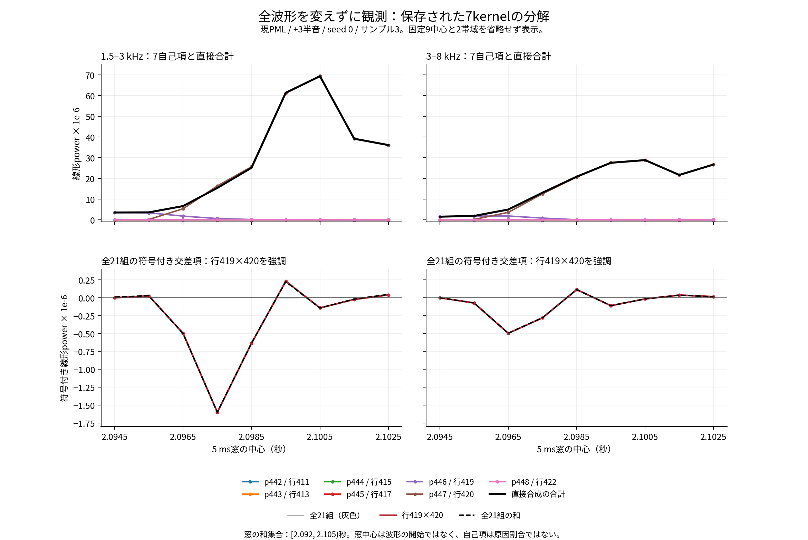
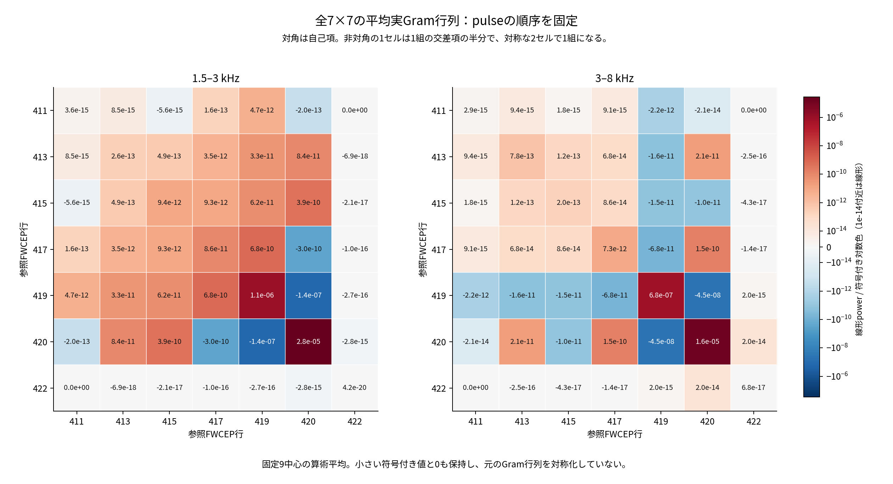
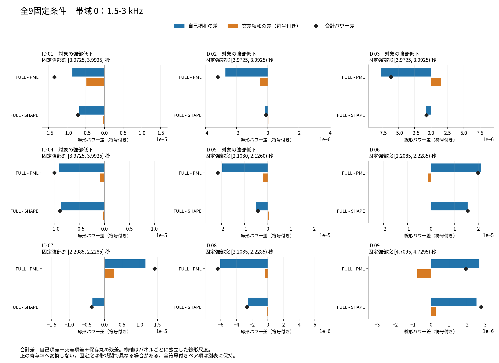
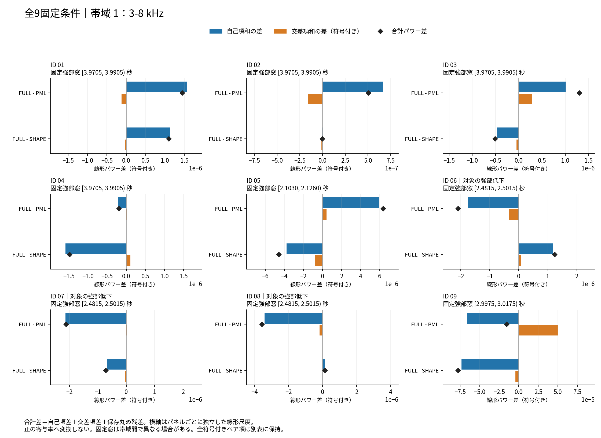
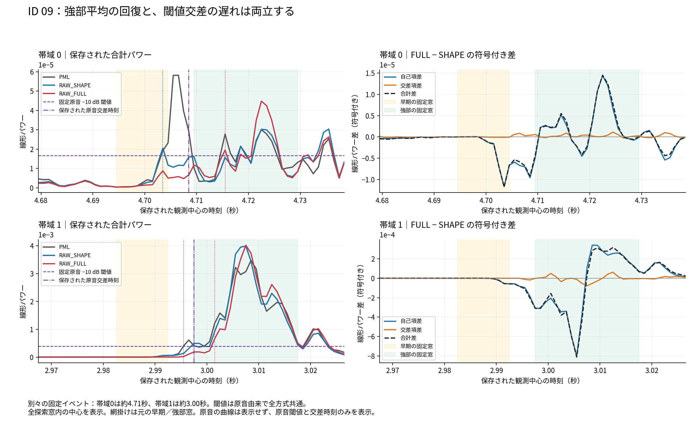

# 現PMLの過渡前成分と包絡移送の損失を、kernel寄与から読む

2026-10-19 JST · 原波形不変の機構説明 · 固定7kernelと、別の4録音・9条件を分離

## 1. 現PMLとの比較を先に読む

現在の基準はPMLのままです。前半の対象は、録音121-121726-0012、+3半音、seed 0の保存PML（SAVED）自身です。後半では別の9条件についてPML／RAW_SHAPE／RAW_FULLの強部損失を比較します。新方式への置換や品質順位の更新ではありません。観測前後の全64,720標本はbyte単位で完全一致しました。原音入力の変更・再解析は行っていません。

|対象|現PMLとの関係|判断|
|---|---|---|
|今回の7kernel観測|同じ保存PMLの内部合成を分解。全標本一致|品質改善は未評価|
|RAW_SHAPE / RAW_FULL|別の9条件・27方式行を追加分解|全18帯域イベントを保持。未採用・品質改善判定なし|
|以前のrow419の解析F0操作|同じ録音の別診断。比較分母はFRESH_1|今回のSAVED分解と混合しない|

[現PML・既存比較対象の指標と順位を見る](https://hiroshiba.github.io/check-nonml-saikyo-vocoder/research/raw-envelope-risk-2026-10-19/index.html) · [既存の比較音声を開く](https://hiroshiba.github.io/check-nonml-saikyo-vocoder/research/raw-envelope-risk-2026-10-19/index.html#listening)

音声は既存公開先へのリンクのみです。新しい音声の生成・複製はありません。リンク先の原音は編集+3半音音声の正解ではなく、内容と元の時刻を確認する参考です。

[原音（参考）](https://hiroshiba.github.io/check-nonml-saikyo-vocoder/research/raw-envelope-risk-2026-10-19/audio/121-121726-0012__original.wav)

[現PML +3半音 / seed 0](https://hiroshiba.github.io/check-nonml-saikyo-vocoder/research/raw-envelope-risk-2026-10-19/audio/121-121726-0012__pitch+3__seed0__PML.wav)

[RAW_SHAPE +3半音 / seed 0（別比較・未採用）](https://hiroshiba.github.io/check-nonml-saikyo-vocoder/research/raw-envelope-risk-2026-10-19/audio/121-121726-0012__pitch+3__seed0__RAW_SHAPE.wav)

[RAW_FULL +3半音 / seed 0（別比較・未採用）](https://hiroshiba.github.io/check-nonml-saikyo-vocoder/research/raw-envelope-risk-2026-10-19/audio/121-121726-0012__pitch+3__seed0__RAW_FULL.wav)

公開WAVはPCM16です。波形同一性を示すfloat64配列SHAとWAVファイルSHAは別の値です。PML音声の元NPY SHAは今回の保存参照NPYと一致し、対象条件を対応付けられます。

## 2. 分かったことと、分からないこと

固定した9中心・2帯域では、最初の2中心の最大自己項はrow419、後の7中心はrow420でした。row420の自己項は9中心平均でも両帯域で最大です。row419とrow420の交差項は時刻で符号が変わり、平均は両帯域で負、つまり打ち消す側でした。

これは1録音・1音高条件・1seedの観測です。約97 Hzが誤り／約195 Hzが正解、音質改善、窓長だけが原因、未来標本由来のpowerの量、ほかの録音への一般化を示しません。自己項の大小を品質順位や原因割合にしません。

## 3. 初回の型仮定失敗から、訂正版の全9確認へ

初回は「post-taper kernelもfloat64」という観測側の仮定で停止しました。保存された7kernelはすべてnative float32、各801標本でした。全波形がfloat64なのは、float64の加算先へ重ね合わせているためで、個別kernelの型を保証しません。

初回は全波形・保存trace・乱数状態が一致していましたが、208標本の再構成と帯域分解へ進めていません。初回の状態は失敗のまま残し、部分的な寄与結論には使いません。

訂正版では、native float32をcastせず保存し、元と同じfloat64加算先へ元pulse順で加算しました。全7capture、全9必須確認、終了コード0を確認。元成果物一覧24ファイルのbytesとSHAも一致しています。

|確認|保存結果|
|---|---|
|入力・実行環境・sourceの固定、実際に読込んだmodule|通過|
|全64,720標本、全保存trace、global RNG|完全一致|
|全7capture、raw→stackのdtype・shape・値・bytes|一致|
|観測窓の和集合208標本の元順加算|保存PMLとbyte完全一致|
|入力・sourceの観測前後、3つの帯域再構成確認|通過|

全波形float64配列SHA256: 18e5e3fd1f46a29e71e7a328270b76d785d3a644343a9aa9e2db55fcec17726a。

|代数的な照合|最大絶対残差|固定許容値に対する最大比|
|---|---|---|
|複素STFT再構成|1.508536e−16|0.0392731|
|power分解再構成|2.032879e−20|0.000378900|
|既存観測powerとの照合|2.371692e−20|0.000411277|

許容値は事前固定の1e−12×尺度、尺度0なら残差厳密0です。補助項目の厳密Hermitian一致はfalseで、共役対称差の最大値は1.186379e−21でした。これは必須確認ではなく、後から対称化・補正していません。上記は保存された照合結果の転記で、この資料作成でFFTやソフトウェアテストを再実行していません。

## 4. 自己項と符号付き交差項を分ける

各kernelの複素STFTをZᵢとすると、合成powerは「7自己項 |Zᵢ|² の和 ＋ 21組の符号付き交差項 2Re(ZᵢZⱼ*) の和」です。自己項だけを合計したり、負の交差項を削ったりしません。

直接の波形対象は[2.094, 2.103)秒の144標本。帯域観測は中心2.0945–2.1025秒の9点、5 ms periodic Hann、hop 1 ms、FFT128です。窓が読む和集合は[2.092, 2.105)秒の208標本です。帯域は1.5–3 kHz、3–8 kHz（上端除外）。

以下は9中心の線形powerの算術平均で、dBの平均ではありません。絶対校正された音圧でもありません。

|pulse / 参照行|1.5–3 kHz|3–8 kHz|
|---|---|---|
|442 / 411|3.586424e-15|2.889634e-15|
|443 / 413|2.632181e-13|7.815923e-13|
|444 / 415|9.422916e-12|1.951685e-13|
|445 / 417|8.648724e-11|7.347624e-12|
|446 / 419|1.058916e-06|6.762879e-07|
|447 / 420|2.815160e-05|1.575382e-05|
|448 / 422|4.196641e-20|6.793702e-17|
|全21交差項の和|-2.875019e-07|-9.001969e-08|
|419×420の交差項|-2.894163e-07|-9.014707e-08|
|直接合成の帯域power|2.892311e-05|1.634009e-05|

古い4tail（row411/413/415/417）とrow422の自己項を合わせた平均は、9.617696e−11 / 8.327342e−12でした。これは指定高域の記述であり、波形全体への無関係を意味しません。

## 5. 9中心を省略せず見る

表中のpower単位は10⁻⁶です。丸め前の全値は[全504項CSV](full-terms.csv)、[全18中心・帯域の合計CSV](full-totals.csv)、[全項表](full-table-ja.md)にあります。0や負の交差項も保存しています。

|中心(s)|419自己 1.5–3|420自己 1.5–3|419×420 1.5–3|419自己 3–8|420自己 3–8|419×420 3–8|
|---|---|---|---|---|---|---|
|2.0945|3.53133|1.00157e-10|-4.14074e-07|1.52245|6.67747e-06|8.36797e-05|
|2.0955|3.38962|0.181448|0.0253886|1.78472|0.170337|-0.0731237|
|2.0965|1.79609|5.34742|-0.497991|1.85738|3.61158|-0.496446|
|2.0975|0.622653|16.3666|-1.60116|0.837664|12.5393|-0.280546|
|2.0985|0.160351|25.623|-0.636215|0.0720868|20.6565|0.113417|
|2.0995|0.024042|61.1101|0.231342|0.0108453|27.6431|-0.110632|
|2.1005|0.00463844|69.4892|-0.142016|0.0012516|28.8482|-0.0163407|
|2.1015|0.00130429|39.1811|-0.0238132|0.000147694|21.6351|0.0371549|
|2.1025|0.000214321|36.0656|0.0397199|4.0143e-05|26.6802|0.01511|

図上段は全7自己項と直接合計、下段は全21交差項を細線で示し、419×420と全交差項和を強調しています。小さい項は線形軸の0付近に重なります。図の横軸は窓中心であり、kernel開始や聴覚的な立ち上がりではありません。

行列図はRe(G)の9中心平均です。対角は自己項、非対角セルは1組の交差項の半分で、対称な2セルを合わせて1組になります。色は符号付き対数型で、10⁻¹⁴付近は線形。色面積を原因割合へ読み替えません。図は既存の保存数値を日本語の凡例で描画し直したものです。信号解析やFFTは再実行していません。

## 6. 波形の支持・帯域観測窓・広帯域RMSは別の量

row420の実非ゼロ支持は2.096125秒からです。それ以前の直接波形へは入りませんが、より早い窓中心でも右側の窓がその支持を読むため、帯域powerは0とは限りません。

|pulse / 行|実非ゼロ支持(s、左閉右開)|直接144標本内の広帯域RMS|
|---|---|---|
|442 / 411|[2.0511875, 2.0946875)|4.644053e-06|
|443 / 413|[2.0606875, 2.1037500)|3.355591e-04|
|444 / 415|[2.0696875, 2.1126875)|2.785233e-03|
|445 / 417|[2.0785625, 2.1215000)|8.327171e-03|
|446 / 419|[2.0874375, 2.1303125)|1.460856e-02|
|447 / 420|[2.0961250, 2.1389375)|7.996615e-03|
|448 / 422|[2.1046875, 2.1474375)|0.000000e+00|

row422は直接144標本には入らず、最後の2.1025秒中心の窓へ末尾5標本だけ入ります。その自己項は最後の窓で3.776977e−19 / 6.114332e−16、他8中心で0です。

広帯域RMSは各kernelを直接144標本で測った量であり、帯域powerの9窓と範囲も周波数も異なります。RMSは相互干渉を含む合計へそのまま加算できません。row417の広帯域RMSがrow420と同程度でも、指定高域自己項が小さいこととは矛盾しません。

## 7. 以前のrow419限定操作との関係

別の既存診断では、row419だけのCheapTrick解析F0を97.327181 Hzから0.5倍／2倍に変えました。原音波形・合成時計・合成F0等は固定です。主比較はFRESH_HALF/DOUBLE 対 FRESH_1であり、今回のSAVEDと分母を取り違えません。

|固定区間(s)|帯域(kHz)|0.5倍の主差(dB)|2倍の主差(dB)|2倍の原音比(dB)|
|---|---|---|---|---|
|[2.080, 2.094)|1.5–3|+9.284521|-12.461385|+2.087233|
|[2.080, 2.094)|3–8|+7.069129|-12.367156|-1.388124|
|[2.094, 2.103)|1.5–3|+1.428058|-0.080471|+25.830169|
|[2.094, 2.103)|3–8|+0.775729|-0.157427|+23.700840|
|[2.103, 2.126)|1.5–3|+0.002710|-0.000146|-0.130748|
|[2.103, 2.126)|3–8|+0.001235|+0.000047|-0.836192|

2倍操作では前半の高域powerは低下しましたが、次の[2.094, 2.103)秒には大きな差が残りました。今回のrow420自己項の大きさはその残差と整合しますが、row420も変えれば改善すると示したものではありません。0.5倍条件と強部も省略せず示します。

FRESH_1とSAVEDは完全同一ではありません。既存診断では+3の最大標本差3.7253e−9、全録音の差RMS 5.1843e−11でした。今回の訂正版と既存SAVEDの全標本完全一致とは別の比較です。

## 8. オクターブ選択だけでは過渡の解析支持を制限できない

CheapTrickの理想対称3周期窓の右端を t + 1.5/F0 とし、既存診断の固定cutoff 2.103秒を超えない条件だけを考えます。これは保存F0を用いた幾何であり、新しいF0推定や波形測定ではありません。

|行|解析中心(s)|保存解析F0(Hz)|原値の理想右端(s)|2倍時の理想右端(s)|cutoff以内に収まる下限(Hz)|
|---|---|---|---|---|---|
|419|2.095|97.327181|2.110412|2.102706|187.5|
|420|2.100|99.822741|2.115027|2.107513|500.0|

row419はcutoffまで8 msあり、187.5 Hz以上でこの幾何条件を満たします。row420は3 msしかなく、約99.823 Hzを2倍にしても右端は約2.107513秒です。

500 Hzへ変更すべきという提案ではありません。仮に約200 Hzが正しいとしても、別の近接行では後続の強い部分を窓が含むことを示すだけです。解析F0の正解と、非定常な包絡の時間支持を扱う課題を区別します。

実装の標本丸め・窓端の重み・包絡の変化量は別問題です。cutoffは人手の音素開始正解ではありません。窓が含むことだけで出力先行量や知覚的な害は決まりません。公式[WORLD CheapTrick実装](https://raw.githubusercontent.com/mmorise/World/master/src/cheaptrick.cpp)のF0依存窓を参照していますが、実測環境のbundled C++と公開masterが完全同一とは主張しません。

## 9. 固定7kernelの実効maskは全周波数でM=1

保存された実効maskを厳密比較したところ、7kernel×2049bin＝14,343binすべてがM=1でした。M=0と0<M<1はともに0件。低域、DC、Nyquistも含みます。したがって、この固定区間の主因を「分数Mの複素冪非線形」とする説明は保存値と両立しません。

|pulse / 参照行|全2049binのM=1|1.5–3 kHzの分数M|3–8 kHzの分数M|
|---|---|---|---|
|442 / 411|2049 / 2049|0 / 384|0 / 1280|
|443 / 413|2049 / 2049|0 / 384|0 / 1280|
|444 / 415|2049 / 2049|0 / 384|0 / 1280|
|445 / 417|2049 / 2049|0 / 384|0 / 1280|
|446 / 419|2049 / 2049|0 / 384|0 / 1280|
|447 / 420|2049 / 2049|0 / 384|0 / 1280|
|448 / 422|2049 / 2049|0 / 384|0 / 1280|

これは合成rFFT長4096の実効maskです。帯域power観測のFFT128とは別です。全周波数はbin[0,2049)、1.5–3 kHzは[384,768)、3–8 kHzは[768,2048)で、最後の帯域はNyquistを除きます。分類はM==0、0<M<1、M==1で、許容差や端点への丸めは使っていません。元配列は857×2049のfloat64で、結論は固定7pulseだけに限定します。

[全21集計行のCSV](mask-counts.csv)と[端点・元SHA・厳密比較の記録](mask-counts.json)に根拠を残します。bin数はpowerで重み付けした寄与率でも、物理的な有声／無声の正解判定でもありません。

理想Gaussian法則で、F0・M・スペクトル包絡・配置を固定し、Gaussian乱数だけについて期待値を取ります。乱数列の符号対称性、正規化分母の偶性、固定された外側の線形処理を仮定すると、この全M=1の7kernelでは条件付き平均が0になります。有限seedの実波形が0、局所powerが0、あるいは浮動小数実装の期待値が厳密に保存されたという実測結果ではありません。

この範囲で平均を引き、全セルに共通の絶対時刻包絡a(t)を、色付け・配置後の残差へ掛けるなら、理想式では当該区間の元波形への後掛けに一致します。セル別に異なる包絡やFFT前の包絡へ、この等価性を一般化しません。平均枝を保護する新しい効果や、品質改善が示されたわけではありません。必要な共振tailの削減や側帯波などの交換条件も残ります。完成波形全体、別時刻・音高・録音へ広げず、有声／無声判定の滑らか化だけを解決策としません。

## 10. 旧寄与観測の停止と、独立に確定した実効mask集計

9条件×3方式、計27行の旧kernel寄与観測は、一部の再構成確認で停止しました。この旧runは失敗のまま保持します。保存captureだけを使った新契約の派生数値計算と寄与解釈は完了し、次節へ追加しました。固定7kernelの9中心を、その別9条件の代表値として流用しません。

停止はcondition-01の複素FFT再構成について、FFT出力binを分母にした旧相対尺度が4点で基準を超えたためでした。その4点の80桁直接DFTによる補助診断では、窓掛けとFFTの有限精度差（約1e−17～1e−16）の符号付き和が保存残差と整合しました。4点のOLAと最終減算の誤差は0、最後のZ加算差は約1e−21でした。[4点の保存診断結果](fft-four-point-diagnosis.json)を添えます。

これは数値的な原因切分けで、FFT実装の形式的な誤差証明ではありません。旧失敗は変更しません。別の観測契約では窓付き時間入力のL1和を尺度にし、閾値1e−12を維持した派生計算を行いました。失敗を見た後の尺度変更であること、各binの相対精度保証にはならないことを明記します。保存captureを使い、全27再合成は行っていません。新契約の全9条件・27行の成立と、旧per-bin尺度の全18失敗点を次節で併記します。

追加の全条件について、状態・現PMLとの対応・固定窓・全自己項と符号付き交差項を保存しました。既存7kernel結果はそのまま残し、別条件を足した平均で上書きしません。

前節の全M=1確認は、成功済みの固定7kernelに対する別の保存値集計です。停止した27条件へその結果を流用しません。

ただし、別に成立している全27組の波形同一性と9条件の保存captureから、実効maskの分布だけを集計しました。9条件は各3方式（PML / RAW_SHAPE / RAW_FULL）で計27組です。各条件で方式間のM配列bytesが一致しているため、Mは1コピーだけを数えています。失敗した寄与分解配列・自己項・交差項は使っていません。

|条件|録音|半音|seed|セル枠|M=0|分数M|M=1|全周波数M=1のセル枠|
|---|---|---|---|---|---|---|---|---|
|01|1188-133604-0003|0|20261015|14|1502|577|26607|2|
|02|1188-133604-0003|-3|0|11|1272|481|20786|1|
|03|1188-133604-0003|3|0|17|1396|697|32740|2|
|04|1188-133604-0003|3|20261015|17|1396|697|32740|2|
|05|121-121726-0012|-3|0|9|1776|204|16461|2|
|06|1089-134686-0032|0|20261015|24|3949|972|44255|8|
|07|1089-134686-0032|-3|0|21|3977|852|38200|7|
|08|1089-134686-0032|-3|20261015|21|3977|852|38200|7|
|09|1221-135766-0005|0|0|41|12887|1668|69454|7|

合計は4録音・175セル枠・358,575binで、M=0が32,132、分数Mが7,000、M=1が319,443。全周波数M=1は38/175セル枠です。残り137枠には分数Mがあります。条件03/04、07/08ではM配列が各対で同一であり、セル枠数やbin数は独立標本数ではありません。

全選択集合は帯域ごとの探索区間の和集合です。各帯域の固定強部へ入る可能支持に限定すると、条件09の3–8 kHzは12セル×1280bin＝15,360binすべてM=1でした。他17組の条件×帯域強部支持には分数Mがあります。ただし、その12セルのうち全周波数M=1は4セルだけで、残り8セルの低域M<1が切出し・taper・STFTで帯域混合する可能性を除けません。この帯域だけのM=1から、完成3–8 kHz成分の条件付き平均0とは結論しません。

[全525セル・帯域行](additional-mask-cell-counts.csv)、[全54支持・帯域行](additional-mask-region-counts.csv)、[保存根拠と集計規則](additional-mask-summary.json)を示します。Mの数は品質点数・原因割合・平均枝powerではありません。分数Mがあることも、平均保護や後掛け包絡が改善することを示しません。このmask集計は寄与分解とは独立した保存値集計で、新しい基準での寄与再評価は次節へ分けます。

## 11. 別9条件の寄与分解：強部損失は干渉だけでは説明できない

**既知の強部低下8イベントでは、FULL−PMLの自己項総和が8件すべてで減り、その差の絶対値は交差項差より大きくなりました。交差項差は6件で低下を加え、2件で一部を相殺しました。** 固定した計算表現の符号付きpower分解であり、自己項に「原因の何％」を割り当てるものではありません。

|確認・対比|保存結果|解釈の限界|
|---|---|---|
|新契約の派生計算|9/9条件、27/27方式行、終了コード0|旧失敗後に観測尺度を改訂。旧runは失敗のまま|
|新normwise尺度|時間入力L1基準、η最大3.0547323575163517e−16、閾値1e−12|各notch binの相対精度や理論誤差上界の保証ではない|
|旧per-bin尺度のfalse|全18点。条件順4/1/4/3/1/0/3/2/0|初回停止で観測した4点を含み、消去・成功への改訂なし|
|強部低下8件のFULL−PML|全8件でΔS<0かつ絶対ΔS>絶対ΔC|干渉だけによる損失、という説明は支持されない|
|同8件のFULL−SHAPE|6件で強部低下、ID06/08の該当帯域では上昇|尺度復元を一律に外せば解決、とは言えない|
|ID09・1.5–3 kHz|FULLはSHAPEより強部平均+0.765 dB、固定−10 dB交差は12 ms遅い|平均強部の回復は早い交差を保証しない|

4録音・7録音音高組から、既知の強部低下8条件と交差遅れ1条件を選んだ**失敗の事後説明集合**です。9独立録音・27独立実験・175独立セルとは数えず、全5録音90条件の代表性や品質優位を主張しません。固定7kernelとは別の観測集合です。

自己項S、符号付き交差和C、観測power PにはP=S+C+保存丸め残差の関係があります。差ΔC<0は交差和の低下であり、必ずしも負の相殺が増えたことではありません。負・正・零の全pairを保持し、交差項をdB化・片側セルへの配賦・非負原因割合へ変換しません。

[全18イベントの表と3枚の図を読む](stage-b/index.html) · [全18イベントCSV](stage-b/all-18-strong-events.csv) · [全11,820 pair-region行](stage-b/all-region-signed-pairs.csv) · [全1,050 self-region行](stage-b/all-region-self-terms.csv)

強部窓は元の固定窓を維持し、帯域間で時刻を揃えていません。各パネルは独立した線形横軸です。ID01〜08の16帯域イベントでは、FULLの原音相対−10 dB交差差は−1〜+1 msでした。PML相対の後退を、そのまま原音の立ち上がり遅延とは呼びません。ID09は原音より+7/+4 ms遅れた別の時間帯です。

**ID09図には原音のpower曲線がありません。原音について示すのは固定閾値と保存交差時刻だけです。** 全保存search中心を示し、strong平均だけでは隠れる早期の自己項減少と後の増加を区別します。原音の音素開始正解、物理的な雑音分離、source-AMの原因、F0正解を確定した結果ではありません。

旧27行の全波形・時計・乱数の同一再現証拠はSHAを照合して再利用し、今回その再合成はしていません。一方、保存native captureからの全27観測入力OLA byte一致は新たに確認してから分解しました。condition01の旧182配列も全件byte一致です。[保存条件・原音閾値](stage-b/observation-contract.json)、[全27数値状態](stage-b/all-27-numerical-status.csv)、[旧18失敗点](stage-b/all-18-legacy-Z-failures.csv)、[同一性と元SHA](stage-b/source-evidence.json)を参照してください。

## 12. 適用範囲と数値の出典

この資料からは、F0正解、音質改善、採用方式、未来依存の因果量、窓長だけの原因、一般的な過渡対策を決定しません。前半の寄与分解は1録音・1seed・+3半音・固定9中心の観測です。追加の寄与分解とM分布は別の4録音・9条件に限定します。100音声以上での品質比較や自動MOSの新規評価を代替しません。

- [要約・同一性・保存残差](observation-data.json)
- [全自己項・全交差項の保存値](saved-terms.json)
- [既存row419操作の保存値](earlier-row419-data.json)
- [解析窓の幾何と計算式](geometry-data.json)
- [固定7kernelの実効mask集計](mask-counts.json)
- [追加9条件の実効mask集計](additional-mask-summary.json)（寄与分解とは独立）
- [追加9条件の全表・図・残差](stage-b/index.html)
- [4方策と後掛け包絡の研究要約](research-notes/index.html)（実行前の計画を保存した履歴）
- [既存音声への対応と確認記録](existing-audio-links.json)
- [数値根拠対応表](NUMERICAL-EVIDENCE-ja.md)
- [音素の補助評価：準備・調査と未実行範囲](phonetic-observation-status-ja.md)（PPGの実測結果ではなく、実験成功に数えない）

入力結果ZIP SHA256: 9d5ff42caaef88c56fa766086f83ce3de29f634de76a5b73d7417ca21213452b。元成果物一覧SHA256: 0f8bfebaf86bd705c7de0798c675a9f5359109ea26b5c396fb318d92bfed4eb0。

既存音声の出典は[LibriSpeech / OpenSLR SLR12](https://www.openslr.org/12/)、LibriSpeech (c) 2014 Vassil Panayotov、[CC BY 4.0](https://creativecommons.org/licenses/by/4.0/)です。加工・変換・全著者の記録は[既存公開レポートの出典節](https://hiroshiba.github.io/check-nonml-saikyo-vocoder/research/raw-envelope-risk-2026-10-19/index.html#sources)を参照してください。本稿には音声を同梱していません。

本稿は2026-10-19 JST作成の追加資料です。資料作成は既存の数値・図の整理だけで、再合成・FFT再実行・テスト追加／実行・新候補生成・GitHub書込みは行っていません。

別候補の後掛け30条件は生成済みですが、品質は未測定です。この資料では新候補の音声・品質結果を掲載せず、実行前の研究要約を原文のまま保存しています。計画中と書かれた履歴と現在の状態を区別してください。
