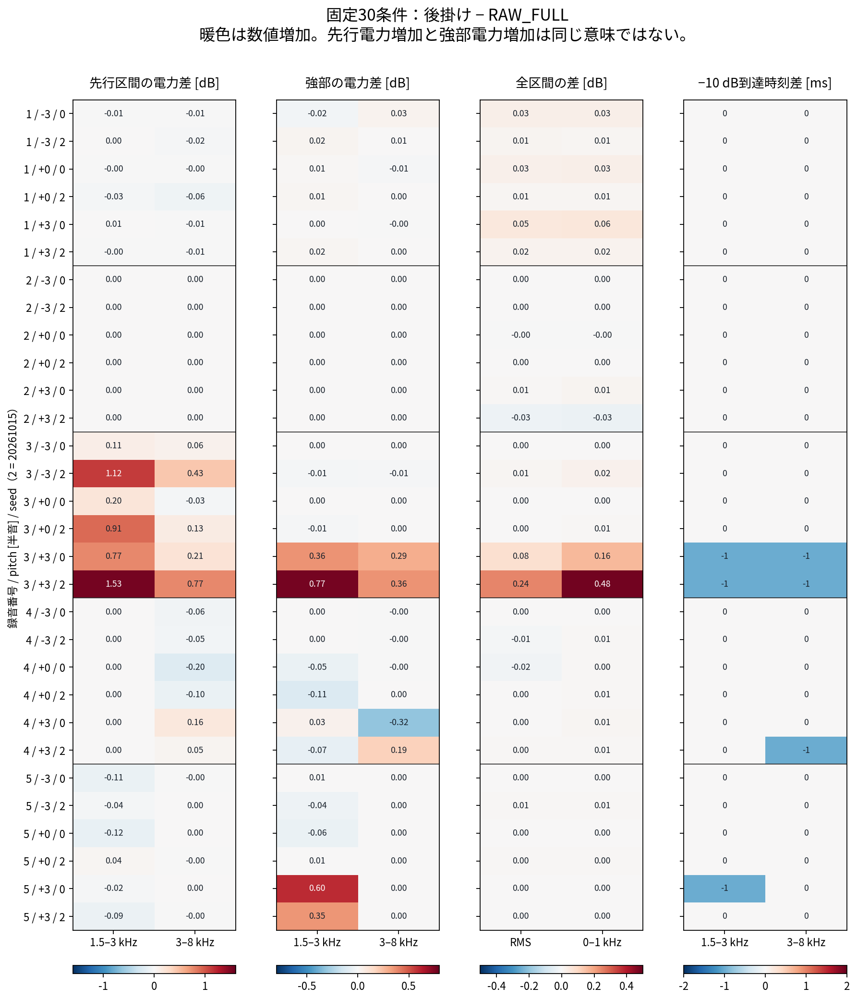
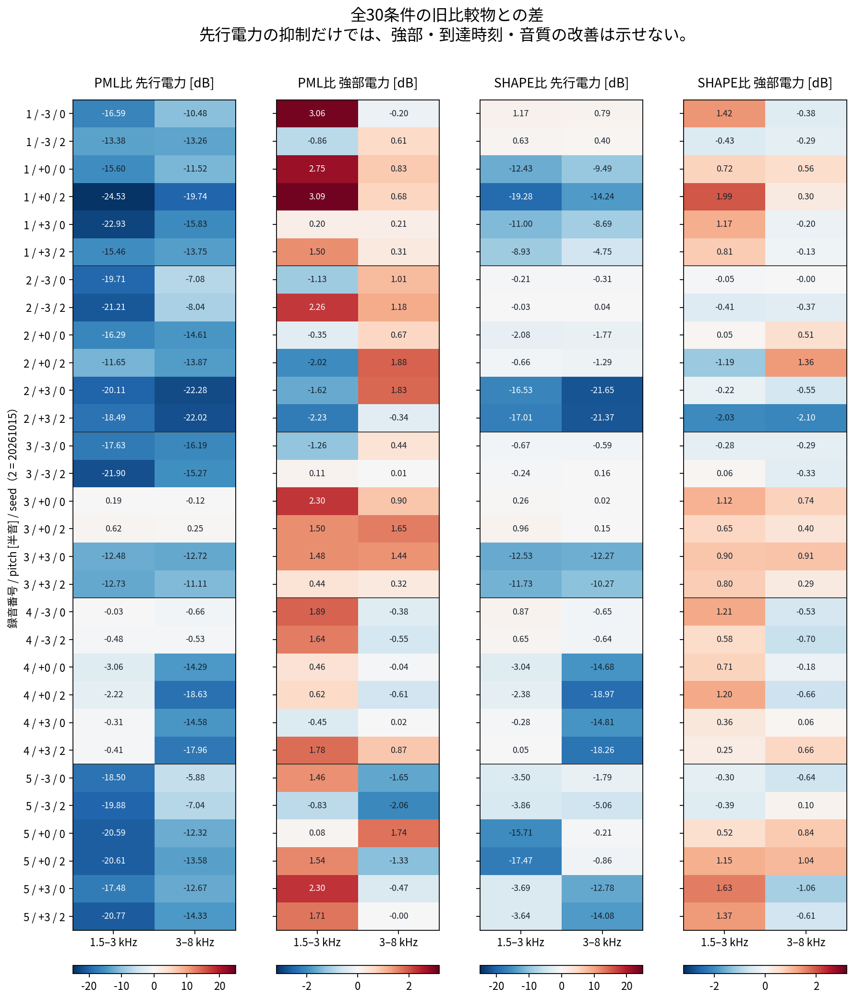
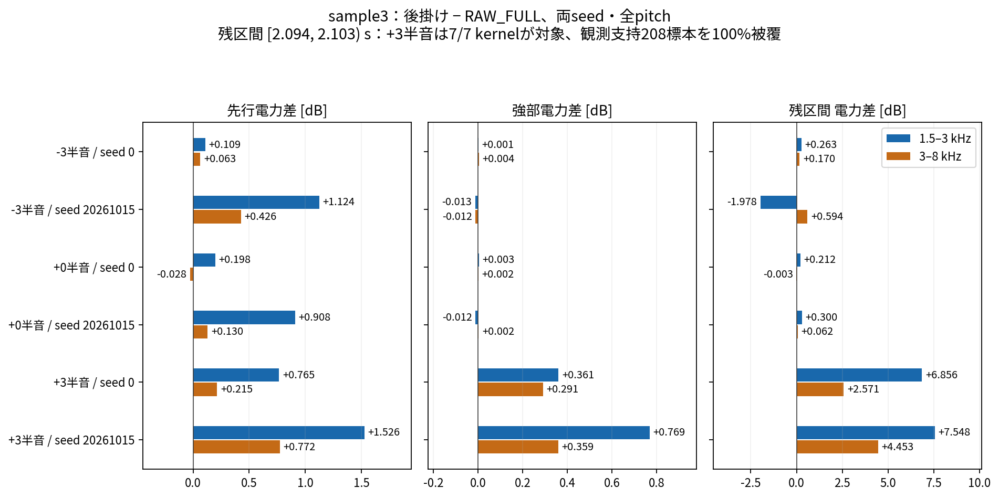
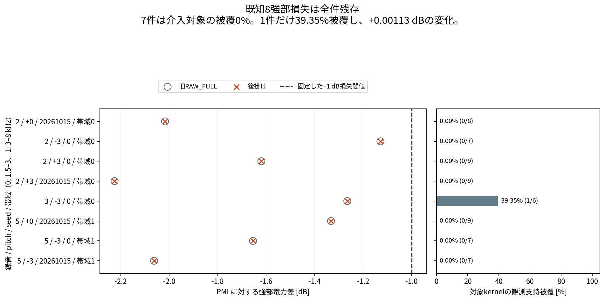
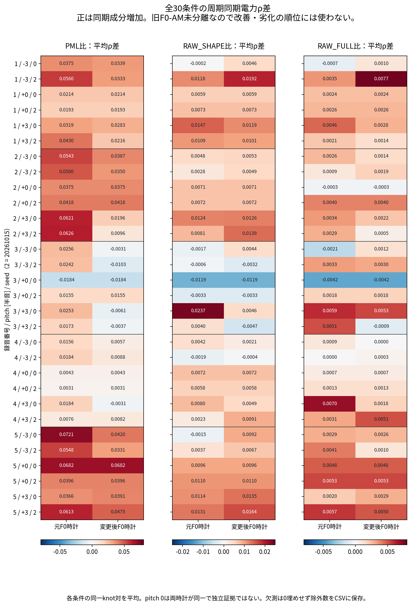

# 全M1限定の後掛け包絡：PMLとの30条件比較

現在の開発ベースはPML。RAW_POSTCOLOR_M1は未採用の比較試行である。新30条件の生成と保存音響観測の独立確認は完了した。新候補の品質結果を統合した。予測MOSだけに単指標の記述順位を付け、採用順位・総合順位は作らない。

試聴と折りたたみ表は [HTML](index.html) を参照。通常表示は原音・PML・今回試行の5録音。RAW_FULL対照とsample3 ±3半音・両seedは補助表示に置く。原音は内容と元の時刻の参考であり、音高編集音の正解ではない。

全30条件は5録音×3音高×2seed。100音声以上の固定品質比較を満たす規模ではなく、30条件・60帯域イベント・周期観測点を独立録音数として扱わない。独立録音は5本である。

音響差の符号は良否順位ではない。先行電力の減少、強部電力の増加、閾値到達の早さだけでは総合的な改善と判定できない。

## 品質追補：単指標の記述順位と悪化

PML比で予測MOSは15/30条件上昇、15/30条件低下。0.15超の固定低下は10/30条件・3録音で発火し、録音4は全6条件で固定低下。一方、録音2は全6条件で上昇した。全体平均差−0.0148だけで局所差を隠さない。

| 予測MOSの記述順位 | 方式 | 5録音等重み平均 |
|---:|---|---:|
| 1 | RAW_FULL | 3.4326 |
| 2 | RAW_SHAPE | 3.3979 |
| 3 | PML | 3.3332 |
| 4 | RAW_POSTCOLOR_M1 | 3.3184 |

各録音の3音高×2seedを平均して5録音を等重み平均。単一予測指標の記述順位であり、採用順位・総合順位・有意差を意味しない。F0/有声欠落率は方式ごとnative由来の支持・分母が異なるため順位を付けず、原音F0真値との誤差とは扱わない。固定害は各0/20件だが、閾値内のF0悪化7条件・欠落率悪化5条件も残す。native10条件は適用外。

ASRは全文を扱える2録音・同じ12条件でPML/FULLとCER/WER同値。録音3の−3半音seed0はSHAPEの2/20文字誤りに対し3/20、WERは1/5で同値。残る18条件は部分GT未整備で欠測。原音は2録音ともCER/WER誤り0。全値・分母・欠測・悪化は [品質HTML](quality/index.html)、[固定した品質本文](quality/REPORT-ja.md)、[品質JSON](quality/quality-values.json) に保持する。

## 結果の要点

PML・RAW_SHAPE・RAW_FULLを参照した全30条件の比較を保持した。今回の後掛けは、sample3の+3半音でRAW_FULLより強部電力を0.29–0.77 dB増加させ、−10 dB到達を1 ms早めた。一方、同じ条件の先行電力は0.21–1.53 dB、固定残区間の電力は2.57–7.55 dB増加した。**強部増加と残留の増加が同時に起きており、原音境界の回復や音質改善とは結論できない。**

既知のPML比1 dB超の強部損失8件は全件残った。ただし7件は対象kernelが当該強部の観測支持を全く覆わないため、当該強部の保存観測値はexact不変だった。波形全区間のbytesが不変という主張ではない。残るsample3・−3半音・seed 0・1.5–3 kHzだけは、1/6 kernelが対象で観測支持の39.35%を覆い、強部が0.00113 dB増加した。**「8件全てで後掛けの効果がなかった」という一般化は不適切。**

自動MOS・F0・無声誤り・ASR等の新候補品質値は、音響集計の作成時点では未取得だった。その後に別工程の品質結果を受領し、本資料の冒頭および品質追補へ統合した。音響観測と品質指標の証拠は区別し、採用判断は行わない。独立録音は5本であり、30条件や60帯域イベントを独立な音声数として扱わない。

## 比較の定義と来歴

- 候補ID：`RAW_POSTCOLOR_M1`。5録音 × pitch 0/−3/+3半音 × seed 0/20261015 = 30条件、全件完了。
- 参照：同一case/pitch/seedの既存PML・RAW_SHAPE・RAW_FULL、計90波形。再合成していない。
- 旧90参照の波形SHA、全保存観測、およびPML比較辞書が、新試行で固定した参照記録と全件一致した。
- 完了記録に列挙された229成果物のbytes/SHA、完了状態、exit 0、30条件の一意性が照合済み。保存観測の数値と図は独立確認済みである。
- 音響・周期の再集計は保存JSON/CSVの算術・集計・図示だけ。元波形に対する新FFT・再合成・モデル・閾値探索は行っていない。試聴用の保存波形の形式変換は末尾に別記した。
- dBは候補/参照。電力は10 log10、RMSは元保存済み20 log10値。到達時刻差は候補−参照で、負は早い。局所2帯域は[1500,3000)、[3000,8000) Hz。低域は[0,1000) Hz。
- 元の80標本periodic Hann、16標本hop、128点観測器と固定early/strong/search区間・P*を継承。−30/−20/−10 dBの固定到達時刻を全て保存した。今回は到達関連720比較が全て取得可能で、新たな非到達はない。
- −10 dB時刻は固定観測器の閾値到達で、知覚的な発音開始ではない。1 msは観測hop一つに相当する。

主な固定SHA：

- 準備freeze：`18e1dd92748c10cec669c88023470e23ca93c6004fef43c3d3f7ea4498c759cb`
- 結果ZIP：`2d259ffd35ee4f2755db9675898c81d49269a140c0c1a6137d060af321f65382`
- 最終delivery receipt：`56cfc77a7ee958570970ef52ab9c38df5bb45b8ef9a92f3af94464059afa9dc9`
- 旧B fullreceipt：`f0fb857bda6041d7a174c67266a643015347a981c14938dcfd29cbb2ad14337b`

新runtimeのbinary/hashは保存されている。過去Bのbinary hashは未保存で同一性未確認であり、旧90と実行バイナリの同一性を確認済みとはしない。

## 全30条件の集計

以下の範囲・中央値は記述統計であり、条件やknotを独立試行とする推測統計ではない。

|参照|先行電力差60件：範囲、中央値 dB|強部電力差60件：範囲、中央値 dB|強部1 dB超低下|−10 dB到達2 ms超遅延|全波形RMS差30件：範囲 dB|低域差30件：範囲 dB|
|---|---|---|---:|---:|---|---|
|PML|−24.530～+0.622、−14.079|−2.225～+3.092、+0.453|8/60|38/60|−0.065～+0.244|−0.059～+0.494|
|RAW_SHAPE|−21.646～+1.168、−2.711|−2.099～+1.985、+0.173|4/60|8/60|−0.038～+0.244|−0.041～+0.487|
|RAW_FULL|−0.200～+1.526、0|−0.316～+0.769、0|0/60|0/60|−0.027～+0.244|−0.028～+0.484|

- PML比の先行電力3 dB以上低下は、帯域0で23/30、帯域1で26/30。強部損失8件と到達遅延38件は旧RAW_FULLの件数と同じで、先行抑制だけを成功としない。
- RAW_SHAPE比の先行3 dB以上低下は各帯域15/30。RAW_FULL比では各帯域0/30で、新たな3 dB以上の先行低下はない。
- RAW_FULL比で先行電力は19/60増加、23/60低下、18/60 exact不変。強部電力は25/60増加、15/60低下、20/60 exact不変。
- 強部のexact不変20件は全て対象kernelの観測支持被覆が0%。対象被覆0の20件も全てexact不変だった。
- RAW_FULL比の最大強部低下はsample4・+3半音・seed 0・3–8 kHzの−0.31569 dBで、対象12/14 kernel、被覆100%。固定した1 dBの害フラグ未満でも、この不利な変化は残す。
- RMSの絶対変化1 dB超、0–1 kHz電力1 dB超低下は3参照とも0/30。これは固定した二つの観測項目だけの結果で、低域の無害性全般や品質の保証ではない。

図1は全30条件のRAW_FULLとの差、図2はPML/RAW_SHAPEとの差。色は数値の符号で、良否順位ではない。

## sample3の±3半音・両seed

残区間は事前固定の[2.094,2.103)秒、整数[33504,33648)。区間内に中心を持つ80標本観測窓は9個で、その全支持のunionは208標本。nominalの144標本とは区別した。

下表は全てRAW_FULL比。帯域0/1の順は1.5–3 / 3–8 kHz。

|pitch|seed|先行差0 / 1 dB|強部差0 / 1 dB|残区間差0 / 1 dB|−10 dB時刻差0 / 1 ms|RMS差 dB|低域差 dB|
|---:|---:|---|---|---|---|---:|---:|
|-3|0|+0.109 / +0.063|+0.001 / +0.004|+0.263 / +0.170|0 / 0|+0.001|+0.003|
|-3|20261015|+1.124 / +0.426|−0.013 / −0.012|−1.978 / +0.594|0 / 0|+0.011|+0.022|
|+3|0|+0.765 / +0.215|+0.361 / +0.291|+6.856 / +2.571|−1 / −1|+0.080|+0.163|
|+3|20261015|+1.526 / +0.772|+0.769 / +0.359|+7.548 / +4.453|−1 / −1|+0.244|+0.484|

+3半音の残区間は7/7 kernelが対象、対象unionが208/208標本、対象外unionとの重複0。従ってここでの残留増加は、対象支持が無かったための不変とは区別できる。原音との比較でも、+3残区間は帯域0が+10.603/+10.707 dB、帯域1が+5.000/+6.480 dBである。−3のseed 20261015・帯域0はFULL比−1.978 dBとなるが、なお原音比+2.721 dB。両seed・両帯域で一様に残留が減るという結果ではない。

+3の−10 dB到達はPML比ではseed 0が両帯域+5 ms、seed 20261015が両帯域+3 ms。原音比では両seed・両帯域−1 ms。PML比の「遅延短縮」と原音の境界への接近を同一視できない。

−3ではPML比の−10 dB到達差がseed 0で+11/+11 ms、seed 20261015で+12/+8 msのまま。原音比は0/0 ms、0/−1 ms。閾値到達の基準相手によって解釈が変わる。

## 既知8強部損失と被覆

|録音|pitch|seed|帯域|旧FULL/PML dB|後掛け/PML dB|後掛け/FULL dB|対象kernel / 全交差kernel|観測支持被覆|
|---:|---:|---:|---:|---:|---:|---:|---:|---:|
|2|0|20261015|0|−2.016980|−2.016980|0|0/8|0%|
|2|−3|0|0|−1.128665|−1.128665|0|0/7|0%|
|2|+3|0|0|−1.619776|−1.619776|0|0/9|0%|
|2|+3|20261015|0|−2.225170|−2.225170|0|0/9|0%|
|3|−3|0|0|−1.265353|−1.264225|+0.001128|1/6|39.35%|
|5|0|20261015|1|−1.332580|−1.332580|0|0/9|0%|
|5|−3|0|1|−1.654146|−1.654146|0|0/7|0%|
|5|−3|20261015|1|−2.062219|−2.062219|0|0/7|0%|

ここでの被覆は中心がstrongに入る全80標本窓unionに対し、元taper非0の録音内kernel支持が覆う割合。振幅・電力の寄与率ではない。対象外kernelも同じ支持に重なることがあり、対象unionと対象外unionの和を100%とみなさない。nominal、全80標本union、Hann厳密0を除いた正重み支持の三つは `data/all-coverage-regions.json.gz` に分けて保持した。

15個のcase/pitch幾何で、全kernelに占めるexact全M1対象の割合は3.46～24.90%、中央値12.21%。2seedでは同じ幾何を参照し実行時照合した。sample3はpitch 0が31/721、−3が21/607、+3が72/857。sample3強部の交差対象数は各帯域とも0半音1/8、−3半音1/6、+3半音6/9、観測支持被覆は25.69%、39.35%、100%。

## 周期同期電力ρ：全30 × 3参照 × 2時計

ρは元固定観測器の高域平滑電力を8位相binにまとめ、選択済み7周期の正規化プロファイルの中央値から求める一次周期同期成分の大きさ。元F0時計と変更後F0時計で別々に記述する。正の差は同期成分が増えたという意味で、旧F0-AM、雑音AM、望ましい有声音成分を分離した値ではない。

下表は「各条件の同一knot対のρ差を平均した値」を30条件でまとめたもの。

|参照|時計|条件平均差の中央値|条件平均差の範囲|正 / 負の条件数|
|---|---|---:|---|---:|
|PML|元F0|+0.03425|−0.01844～+0.07210|29 / 1|
|PML|変更後F0|+0.02054|−0.01844～+0.06817|24 / 6|
|RAW_SHAPE|元F0|+0.00652|−0.01189～+0.02371|23 / 7|
|RAW_SHAPE|変更後F0|+0.00693|−0.01189～+0.01922|25 / 5|
|RAW_FULL|元F0|+0.00276|−0.00416～+0.00696|26 / 4|
|RAW_FULL|変更後F0|+0.00183|−0.00416～+0.00774|27 / 3|

- 各variantのknot総数は15,696（2時計込み）、取得15,376、欠測320。元F0時計は7,848中156欠測、変更後時計は7,848中164欠測。欠測理由は固定原音支持の7周期不足で、候補/各参照のstatusは全対exact一致。欠測を0で埋めていない。
- pitch 0の両時計は同一で、重複を保持・表示している。両時計分を別の独立証拠として数えない。
- FULL比の個別knot差は元時計で−0.27436～+0.27351、変更後時計で−0.27436～+0.26950。平均だけでは局所の正負を表せないため47,088対を全件CSVに保持した。
- 原音の非定常フラグは元時計で6,522/7,692取得knot、変更後で6,746/7,684に立つ。旧AM識別boolがfalseのknotも各時計3,120/7,848残す。いずれも今回の除外や採用判定に使っていない。
- sample3・+3のFULL比平均ρ差は、元時計でseed 0が+0.00595、seed 20261015が+0.00513。変更後時計では+0.00532、−0.00090と符号も揃わない。周期AM問題の解消は示していない。

## この実験から言える範囲

1. 対象をexact全M1に限定した固定介入で、少なくともsample3 +3の実際に被覆された残区間の電力が増加した。単に前掛けを後掛けへ移せば残留が消える、という一方向の期待を支持しない。
2. 強部増加や到達が早くなる条件もあるが、sample3 +3では先行/残留増加を伴い、sample4 +3 seed 0では強部が低下した。全30を保持したまま局所差を読む必要がある。
3. 作用位置に加えaの評価支持をセル内からkernel絶対時刻へ延長した。純粋な順序交換だけの因果識別ではない。Lはkernelごとの元rowに依存するため、完成波形全体に共通の単一a(t)ゲートを掛ける方式とも同一ではない。
4. Aは元65tap高域FIR（±32標本）と97tap Gaussian（±48標本）、stride 8格子の補間による左右支持を持つ。後掛けは厳密因果化ではなく、原音境界一致を保証しない。
5. 分数Mが一つでもあればRAW_FULLへ戻る今回の分岐は、M→1の出力連続性を保証しない。一般的な連続VUVモデルや採用候補としての頑健性は未検証。
6. 旧8イベントでの自己項/交差項の原因分析と、今回保存した完成出力の観測は別の証拠である。今回の出力だけから自己項と交差項の変化を分離推定しない。

## 保存された数値の範囲

- `all-30-wide-comparisons.csv`：30条件を横持ち。3参照、2帯域early/strong/−10時刻、RMS/低域、2時計平均ρ、強部被覆。
- `all-30-waveforms.csv`：全30状態・waveform SHA/サイズ・RNG SHA・元cell exact照合・対象割合。waveform本体は元結果のままで、この分析配布へ複製しない。
- `all-180-event-comparisons.csv`：30 × 3参照 × 2帯域のearly/strong/固定害フラグ。
- `all-crossing-comparisons.csv`：30 × 4参照（原音含む） × 2帯域 × 3閾値、720件。
- `all-90-global-comparisons.csv`：RMS、0–1/1–4/4–8 kHz、保存直接差のRMS/peak/mean square、未取得品質状態。
- `all-absolute-event-values.csv`：候補・3参照・原音の絶対電力/時刻、300行。原音は各条件参照として繰り返すが独立録音扱いしない。
- `data/all-coverage-regions.json.gz`：648行。全region、3支持、対象/対象外union・重複・kernel ID。15幾何を各seedの行と対応付けた表示で、30独立幾何ではない。
- `sample3-residual-comparisons.csv`：6条件 × 2帯域 × 4参照 = 48件。
- `known-eight-strong-losses.csv`：既知8件を欠落なく保持。
- `data/all-periodic-knots.json.gz`：候補30+旧90、各2時計の62,784 knot。全列・全行を元のセル文字列のままgzip圧縮JSON表で保持。欠測・旧AM識別・原音非定常を省略しない。元CSVのSHAと完全復元照合は `data/provenance.json` に記録。
- `data/all-periodic-paired-knots.json.gz`：全47,088対のρ差とstatus。
- `all-periodic-summaries.csv` / `all-180-periodic-condition-comparisons.csv`：全variant/時計要約と、数値列に展開した180条件対。
- `summary.json` / `periodic-descriptive-summary.json` / `provenance.json`：要約と入力hash。
- 図はPNGとSVGを併記。図・HTMLの丸め表示の0.00はexact不変を意味しないので、exact判定にはCSV値を使う。

録音番号：1=`librispeech_1089-134686-0008`、2=`librispeech_1188-133604-0003`、3=`librispeech_121-121726-0012`、4=`librispeech_1221-135766-0005`、5=`librispeech_1089-134686-0032`。

## 公開音声・出典・再現記録

新規音声はRAW_POSTCOLOR_M1の9本だけ。5録音の0半音・seed 0、およびsample3の±3半音・seed 0/20261015。保存済みfloat64波形の先頭min(N,80000)標本をgain 1、無正規化、無dither、nearest ties-to-evenのrint(x×32767)でlittle-endian PCM16へ量子化した。mono、16 kHz、最大5秒。clipは9本とも不要、clip countは0。時刻整列・再標本化はしていない。全長波形の結果と公開短音声を区別する。

元NPYファイル/標本列、公開WAV、切り出し範囲、対応PML/RAW_FULLの全SHAとbytesは [audio-manifest.json](audio-manifest.json)。既存の原音・PML・RAW_FULL・RAW_SHAPEの27本は[公開済み比較](https://hiroshiba.github.io/check-nonml-saikyo-vocoder/research/raw-envelope-risk-2026-10-19/index.html)へのURLだけを再利用し、ここには複製しない。既存manifestと保存済み公開WAVのSHA・条件対応を照合した。本資料作成時に既存URLのHTTP再取得、ブラウザ描画、音声再生の確認はしていない。

LibriSpeech (c) 2014 Vassil Panayotov。Vassil Panayotov, Guoguo Chen, Daniel Povey, Sanjeev Khudanpur, “LibriSpeech: An ASR Corpus Based on Public Domain Audio Books”, ICASSP 2015。[原出典 OpenSLR SLR12](https://www.openslr.org/12/)・[論文](https://www.danielpovey.com/files/2015_icassp_librispeech.pdf)・[CC BY 4.0](https://creativecommons.org/licenses/by/4.0/)・[ライセンス全文](https://creativecommons.org/licenses/by/4.0/legalcode)。原資料はLibriVoxの朗読とProject Gutenbergのテキストに基づく。固定抜粋・PML再合成・包絡処理・±3半音の音高編集・PCM16量子化と最大5秒の切り出しを行った。著者・配布元・朗読者による推薦を意味しない。完全な既存帰属表示もaudio-manifest.jsonに保持する。

[原因説明と先行研究](../pml-kernel-pathway-2026-10-19/index.html)、[生成前に固定した研究計画](../pml-kernel-pathway-2026-10-19/research-notes/index.html)を関連資料とする。前計画の「30条件未実施」は作成時点の記録で、その後に本30条件を生成した。

[公開ファイル一覧とSHA](artifact-manifest.json)、[元資料との対応・圧縮可逆性](data/provenance.json)、[品質の公開状態](quality-status.json)。大きい周期・支持の3表はgzip圧縮JSONであり、gzip展開とJSON読取が必要である。[圧縮表の形式・元CSVへの戻し方](data/COMPRESSED-TABLE-FORMAT-ja.md)を併記し、全セル文字列と列順・行順・元CSVのSHAを保持した。3表とも元CSVへ戻すとbytes/SHAが完全一致した。小さい比較CSVは通常どおり開ける。新しいSTFT/mel画像は作成していない。掲載5図は保存済み音響・周期観測の比較図である。
