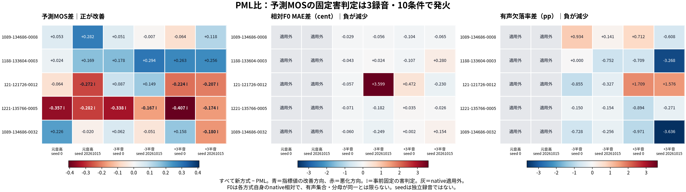
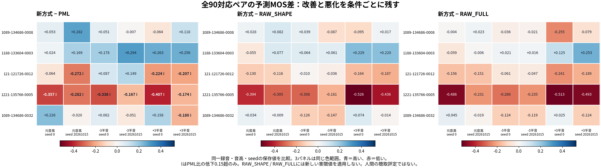
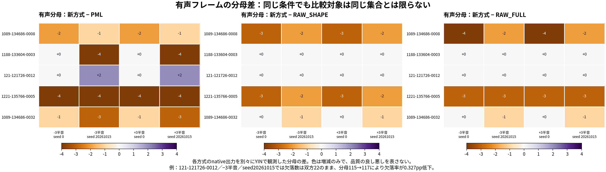
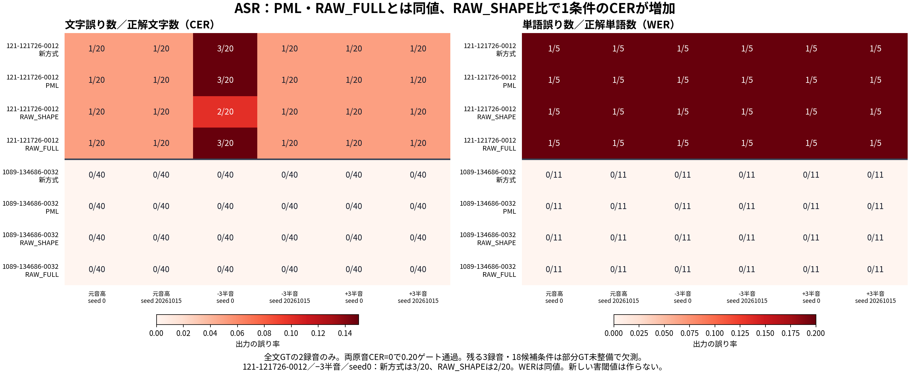

# RAW_POSTCOLOR_M1：固定30波形の品質値は一貫した改善ではない

2026-10-18 UTC。保存済み数値だけの解釈。現ベースはPML。新しい推論・合成・波形再測定・テスト・閾値調整は行っていない。採用判断と音響・周期観測との統合は別工程。

## 先に結論

- PML比で予測MOSが15/30条件で上昇、15/30条件で低下した。低下0.15超の固定害判定は10/30条件、3/5録音で発火した。全条件平均差−0.0148だけではこの集中した悪化を表せない。
- 1221-135766-0005は全6条件で固定MOS害（差−0.1666～−0.4073）。121-121726-0012は元音高のseed20261015と+3半音の両seed、1089-134686-0032は+3半音seed20261015で発火した。
- 有益な差もある。1188-133604-0003は全6条件でMOS上昇（+0.0239～+0.2940）。同録音の+3半音seed20261015では有声欠落数12→7、率8.1633%→4.8951%だった。ただし各方式自身のnative由来の分母も147→143で異なる。
- 編集20条件のPML比F0 MAE増加>10cent、欠落率増加>2ppという固定害判定はともに0件。ただしF0 MAE増加は7条件、欠落率増加は5条件あり、閾値内の悪化は残る。native10条件は適用外なので、この判定で元音高のF0誤差を保証しない。
- ASRは評価可能な12条件でPML・RAW_FULLとCER/WER同値。RAW_SHAPE比では121-121726-0012／−3半音／seed0の文字誤りが2/20→3/20、CER差+0.05（+5pp）。WERは全比較で同値。残り18候補条件は部分GT未整備で欠測。

青は当該指標の改善方向、赤は悪化方向。!は事前固定のPML比害判定。灰色はnative適用外。図は全条件を表示し、複数指標を混ぜた平均順位や総合点は作らない。

## 計測の終端と被覆

数値プロセスはexit2、state=completed_with_missing_observations、complete=true。30行はすべてrecordedで、failedは0。入力閉包は処理前後にSHA照合済み。exit2は以下の予定欠測・適用外が残ることを表し、途中停止ではない。

| 指標 | available | 適用外 | 固定欠測 |
|---|---:|---:|---:|
| UTMOSv2予測MOS | 30 | 0 | 0 |
| 相対F0 MAE | 20 | native10 | 0 |
| 有声欠落率 | 20 | native10 | 0 |
| ASR CER/WER | 12 | 0 | 部分GT未整備18 |

4指標すべてavailableは8/30条件のみ（全文GT2録音×編集2音高×2seed）。残り22条件を0誤差や完全観測として扱わない。旧90品質は再計算せず、30×PML/RAW_SHAPE/RAW_FULLの全90対応ペアへ保存値を接続した。

## 固定害判定：発火した全10条件

規則は新方式−PMLでMOS<−0.15、F0 MAE>+10cent、欠落率>+2pp。等号では発火しない。ASRの害閾値は未設定。SHAPE/FULLへ同じ閾値を後付けしない。

| 録音ID | 音高 | seed | MOS差 | F0 MAE差 cent | 欠落率差 pp | 発火 |
|---|---:|---:|---:|---:|---:|---|
| 121-121726-0012 | +0 | 20261015 | -0.2720 | native適用外 | native適用外 | MOS |
| 121-121726-0012 | +3 | 0 | -0.2240 | +0.4719 | +1.7094 | MOS |
| 121-121726-0012 | +3 | 20261015 | -0.2071 | -0.2298 | +1.5756 | MOS |
| 1221-135766-0005 | +0 | 0 | -0.3566 | native適用外 | native適用外 | MOS |
| 1221-135766-0005 | +0 | 20261015 | -0.2822 | native適用外 | native適用外 | MOS |
| 1221-135766-0005 | -3 | 0 | -0.3379 | -0.0711 | -0.1504 | MOS |
| 1221-135766-0005 | -3 | 20261015 | -0.1666 | -0.1825 | -0.1543 | MOS |
| 1221-135766-0005 | +3 | 0 | -0.4073 | +0.0351 | -0.8939 | MOS |
| 1221-135766-0005 | +3 | 20261015 | -0.1739 | -0.0255 | -0.2708 | MOS |
| 1089-134686-0032 | +3 | 20261015 | -0.1801 | +0.1538 | -3.6362 | MOS |

全30条件のfalse／適用外も[PML-harm-30.csv](PML-harm-30.csv)へ保存した。これらは機械的な固定判定であり、人間の聴取で害を確定したものではない。

## 録音・音高別：2seed平均でも残る違い

各行は同一録音・音高の2seed平均。以下はPML比だけを示す。全3比較先の45行は[recording-pitch-means-45.csv](recording-pitch-means-45.csv)に保持。2seedは録音内の反復であり、独立録音数を増やさない。

| 録音ID | 音高 | MOS差 | F0 MAE差 cent | 欠落率差 pp | 原音比CER差の差 |
|---|---:|---:|---:|---:|---:|
| 1089-134686-0008 | +0 | +0.1674 | native適用外 | native適用外 | 部分GT欠測 |
| 1089-134686-0008 | -3 | +0.0221 | -0.0423 | +0.5371 | 部分GT欠測 |
| 1089-134686-0008 | +3 | +0.0269 | -0.0843 | +0.0520 | 部分GT欠測 |
| 1188-133604-0003 | +0 | +0.0964 | native適用外 | native適用外 | 部分GT欠測 |
| 1188-133604-0003 | -3 | +0.2359 | -0.0096 | -0.3758 | 部分GT欠測 |
| 1188-133604-0003 | +3 | +0.2593 | +0.0868 | -1.9887 | 部分GT欠測 |
| 121-121726-0012 | +0 | -0.1678 | native適用外 | native適用外 | +0.0000 |
| 121-121726-0012 | -3 | +0.1180 | +1.7710 | -0.5909 | +0.0000 |
| 121-121726-0012 | +3 | -0.2156 | +0.1210 | +1.6425 | +0.0000 |
| 1221-135766-0005 | +0 | -0.3194 | native適用外 | native適用外 | 部分GT欠測 |
| 1221-135766-0005 | -3 | -0.2522 | -0.1268 | -0.1524 | 部分GT欠測 |
| 1221-135766-0005 | +3 | -0.2906 | +0.0048 | -0.5823 | 部分GT欠測 |
| 1089-134686-0032 | +0 | +0.1029 | native適用外 | native適用外 | +0.0000 |
| 1089-134686-0032 | -3 | +0.0055 | -0.1545 | -0.4922 | +0.0000 |
| 1089-134686-0032 | +3 | -0.0111 | +0.0779 | -2.3034 | +0.0000 |

**seedで方向が変わる例**：1089-134686-0032の+3半音は、MOS差がseed0で+0.1579607、seed20261015で−0.1801009。2seed平均−0.0110701だけを見ると、後者の固定害を隠してしまう。全seed値は図と90行CSVへ残した。

## 他の固定比較先を含む全90ペア

次表は指標ごとの記述的集計であり、総合優勝や平均順位ではない。差は新方式−比較先。MOSは正、誤差・欠落・CERは負が減少方向。「減少／改善」数は厳密な符号で数え、微小差を統計的改善と解釈しない。平均は、被覆の揃う録音内反復→録音等重みの記述で、推測統計・有意差検定・閾値探索は行わない。

| 比較先 | 指標 | 有効ペア | 平均差 | 最小差 | 最大差 | 改善方向 | 悪化方向 | 同値 |
|---|---|---:|---:|---:|---:|---:|---:|---:|
| PML | 予測MOS | 30/30 | -0.0148 | -0.4073 | +0.2940 | 15 | 15 | 0 |
| PML | 相対F0 MAE cent | 20/30 | +0.1644 | -0.2487 | +3.5991 | 13 | 7 | 0 |
| PML | 有声欠落率 pp | 20/30 | -0.4254 | -3.6362 | +1.7094 | 14 | 5 | 1 |
| PML | 原音比CER差 | 12/30 | +0.0000 | +0.0000 | +0.0000 | 0 | 0 | 12 |
| RAW_SHAPE | 予測MOS | 30/30 | -0.0794 | -0.5262 | +0.2291 | 12 | 18 | 0 |
| RAW_SHAPE | 相対F0 MAE cent | 20/30 | -0.3395 | -4.8737 | +0.1788 | 13 | 7 | 0 |
| RAW_SHAPE | 有声欠落率 pp | 20/30 | -0.0341 | -1.7094 | +2.5641 | 7 | 8 | 5 |
| RAW_SHAPE | 原音比CER差 | 12/30 | +0.0042 | +0.0000 | +0.0500 | 0 | 1 | 11 |
| RAW_FULL | 予測MOS | 30/30 | -0.1142 | -0.5126 | +0.2528 | 7 | 23 | 0 |
| RAW_FULL | 相対F0 MAE cent | 20/30 | -0.3058 | -4.4598 | +0.0287 | 14 | 6 | 0 |
| RAW_FULL | 有声欠落率 pp | 20/30 | -0.0559 | -1.7094 | +1.7094 | 4 | 8 | 8 |
| RAW_FULL | 原音比CER差 | 12/30 | +0.0000 | +0.0000 | +0.0000 | 0 | 0 | 12 |

1221-135766-0005のMOSは、PMLだけでなくSHAPE・FULLに対しても全6条件で低下した。SHAPE比18/30、FULL比23/30の条件でMOSが低下する一方、それぞれ12/30・7/30の上昇も残る。比較先を都合よく選んで優位を主張しない。

### 予測MOSの方式別絶対値（順位付けなし）

3音高×2seedを録音内で平均し、5録音を等重み平均した値。全条件が揃うため30条件平均と一致するが、独立標本数は30とはしない。PMLとの対応差・害判定を先に示した上で、再集計可能な絶対値を残す。単一指標だけで総合品質や採用を決めない。

| 方式 | 5録音等重みMOS | 元音高 | −3半音 | +3半音 |
|---|---:|---:|---:|---:|
| PML | 3.333237 | 3.360338 | 3.446730 | 3.192643 |
| RAW_POSTCOLOR_M1 | 3.318425 | 3.336249 | 3.472584 | 3.146442 |
| RAW_SHAPE | 3.397873 | 3.413184 | 3.545730 | 3.234707 |
| RAW_FULL | 3.432596 | 3.440560 | 3.561859 | 3.295369 |

## F0・有声欠落率：分母と適用範囲

F0と有声欠落率は、各方式の同一録音・同一seedのnative出力を基準にした±300cent編集追従である。原音の絶対F0真値ではなく、各nativeが既に外れている場合を直接検出できない。native10条件で自己比較を計算していない。

- 有声分母が異なるペアはPML比16/20（新−PMLは−4～+2frame）、SHAPE比10/20（−3～0）、FULL比10/20（−4～0）。分母数が同じでも有声位置集合の同一までは保証しない。
- 121-121726-0012／−3半音／seed20261015：PMLの欠落22/115=19.1304%に対して新方式22/117=18.8034%。率は0.3270pp下がるが、欠落数は減っていない。同条件のF0 MAEは2.4627→6.0617cent（+3.5991）。これは固定10cent閾値未満でも見落とすべきでない悪化。
- 121-121726-0012／+3半音：seed0は欠落10/117→12/117（+1.7094pp）、seed20261015は9/115→11/117（+1.5756pp）。両方とも固定2pp閾値未満で、同条件ではMOS害が発火している。
- 1089-134686-0032／+3半音／seed20261015：欠落9/106→5/103、率8.4906%→4.8544%（−3.6362pp）。一方MOSは−0.1801で固定害。欠落率の改善をMOS害の取消しに使わない。

[F0-denominators-60.csv](F0-denominators-60.csv)に各側のnative波形SHA、期待有声数・欠落数・F0誤差の評価フレーム数・誤有声数を保持した。比較波形同士を再解析して共通マスクへ作り直すことはしていない。

## ASR：原音ゲート、離散的誤り数、欠測

公式全文GTを使える121-121726-0012（64,720標本）と1089-134686-0032（65,440標本）だけを評価した。両原音のCERは0、原音CER上限0.20のゲートを通過し、12候補条件はすべてavailable、partialは0。原音ゲートは原音ASRの可用性を確認するもので、新方式の明瞭性を保証するものではない。

- 121-121726-0012：正解20文字・5単語。新方式のCERは−3半音seed0だけ3/20=0.15、それ以外は1/20=0.05。WERは全6条件1/5=0.20。原音は誤り0。したがって「PMLと同値」は「誤認識ゼロ」を意味しない。
- 同録音−3半音seed0のRAW_SHAPEは文字2/20=0.10。新方式は1文字多い3/20で+5pp。WERは双方1/5なので変わらない。新しいASR害閾値は設定しない。
- 1089-134686-0032：正解40文字・11単語。新方式と3比較先は全条件CER/WERとも0。この短い2全文だけから、部分GTのない3録音や他言語・発声へ一般化しない。
- 残る3録音は先頭96,000標本の切出しで、元全文の標本数は1089-134686-0008=107,680、1188-133604-0003=201,760、1221-135766-0005=266,320。公式の切出し範囲GTが未整備なので18候補条件をofficial_excerpt_ground_truth_not_preparedとした。全文転記を短い切出しへ流用していない。

[ASR-pairs-90.csv](ASR-pairs-90.csv)はavailable36ペアに加えて欠測54ペアも含め、公式GT・原音/候補/比較のASR文字列、各側CER/WERの誤り数・分母・率、原音usableを保持する。

## 来歴・固定設定・残る限界

- UTMOSv2-fusion_stage3-fold0、抽出seed20261012、1反復、CPU2thread。予測MOSであり、この新方式に対する人間評定校正ではない。
- 相対F0は既存YIN 65–700Hz、80ms窓・10ms間隔。同方式native基準。欠落率はmissing_voiced_frames / expected_voiced_frames、差は100倍したpercentage point。
- ASRはfacebook/wav2vec2-base-960h revision 22aad52d435eb6dbaf354bdad9b0da84ce7d6156、既存資産SHA、float32/CPU2thread/interop1、greedy CTC、batch1、言語モデルなし。NFKC/casefold/whitespace、句読点除去なし、原音CER上限0.20は不変。
- backend・integrity・runtime-files・corpus・ASR設定は旧90評価版とbyte同一。5原音と新30wave・旧90参照・モデル/runtimeの固定閉包を前後照合。旧90値を再計算していない。科学計測ログには既存依存の非推奨警告やCPU上のCUDA無効化警告が記録されており、警告が無かったとは扱わない。数値failedは0。
- 5録音・4話者、3音高・2seedという限定条件。旧90＋新30は120個の条件出力であり、正式120録音評価ではない。同一録音の2seedやA/B実行を独立標本に増やさない。
- source-periodic AM分離、native絶対F0、知覚的総合品質、48kHz等は今回で確定しない。保存波形の生成来歴では旧Bの過去runtime binary完全同一は未検証という限界も保持する。音響・周期観測の悪化と固定品質の悪化は別々に残し、採用判断は統合して行う。

## ファイル案内

| ファイル | 行数・内容 |
|---|---|
| [paired-90-wide.csv](paired-90-wide.csv) | 全90ペア、4指標の両側値・状態・差・固定害・wave/品質row/evaluation/generation SHA |
| [paired-360-metrics.csv](paired-360-metrics.csv) | 全90ペア×4指標、method ID、欠測理由、状態を含む縦形式 |
| [PML-harm-30.csv](PML-harm-30.csv) | 全30PML対応の固定害true/false/適用外、ASR値 |
| [recording-pitch-means-45.csv](recording-pitch-means-45.csv) | 5録音×3音高×3比較先、2seed平均と有効数 |
| [F0-denominators-60.csv](F0-denominators-60.csv) | 編集20条件×3比較先、native SHAと各側フレーム分母・欠落数 |
| [ASR-pairs-90.csv](ASR-pairs-90.csv) | 全90ペア、GT・ASR文字列・CER/WER誤り数/分母・原音ゲート・欠測 |
| [quality-values.json](quality-values.json) | 元の全90paired記録を保持、要約と全録音別集計、出典 |

CSVはUTF-8 BOM付き。値の空欄は適用外・欠測を示し、対応する状態/理由列で判別する。0へ補完しない。CSVは丸めず保存し、本資料と図のみ表示桁を丸めた。元の記録順（録音→音高0/−3/+3→seed0/20261015→PML/SHAPE/FULL）を維持する。図のSVG版も同梱。

## 出典SHA

- 新summary: ba6b98e9ab6ecc4be1e9c71d5ae7c6ead062e33980fe928510a361a3ab42ff07
- 新completion: 18c0d248a2d988f4002a1b486f9295ef1f6ee8fcdfa606315d4c4f30f8589819
- 旧90summary: 1bee17075fc78e939cb4e36fe10ff23e5be87ff12585bf9758f8e6c0136b7f14
- 新品質freeze: ae5e2ab11825397ec61fcf2e2764e93fa0b30488ac46a28eec8b4b9cdf0ea390
- 旧品質freeze: 62b8d6680fa61c29ce983b3a27cdb00696010e04276b16e14cc58f96c2476baf
